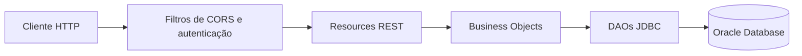

# ConsultaViva — API Java

API REST do ConsultaViva, desenvolvida para a Global Solution FIAP 2026. O serviço acompanha consultas agendadas, permite que pacientes sinalizem dificuldades para comparecer e dá à equipe um fluxo para analisar e oferecer alternativas de atendimento.

<p align="center">
  <a href="https://consultaviva-java.onrender.com">API publicada</a>
  ·
  <a href="https://github.com/EnzoNukui/consultaviva-java">Repositório</a>
  ·
  <a href="#executar-localmente">Execução local</a>
  ·
  <a href="#referência-da-api">Endpoints</a>
</p>

> **Status da publicação.** O serviço está publicado no Render. As funcionalidades que dependem do Oracle ainda aguardam a conclusão e a configuração do banco de dados.

## Índice

- [Visão geral](#visão-geral)
- [Tecnologias e organização](#tecnologias-e-organização)
- [Executar localmente](#executar-localmente)
- [Executar com Docker](#executar-com-docker)
- [Publicação no Render](#publicação-no-render)
- [Configuração do banco](#configuração-do-banco)
- [Autenticação e permissões](#autenticação-e-permissões)
- [Referência da API](#referência-da-api)
- [Fluxo de resgate](#fluxo-de-resgate)
- [Modelos e validações](#modelos-e-validações)
- [Exemplos de requisição](#exemplos-de-requisição)
- [Respostas HTTP](#respostas-http)

## Visão geral

| Recurso | O que permite fazer |
| --- | --- |
| Pacientes e equipe | Cadastrar uma conta de paciente e manter os dados de pacientes e profissionais. |
| Unidades e horários | Organizar locais de atendimento e os intervalos disponíveis dos profissionais. |
| Agendamentos | Cadastrar e remarcar consultas, registrar a resposta do paciente e acompanhar cancelamentos, realizações e faltas. |
| Solicitações de ajuda | Registrar dificuldades e períodos em que o paciente pode comparecer. |
| Propostas de atendimento | Encontrar alternativas, autorizar conversões de modalidade, ofertar horários e confirmar a opção aceita. |
| Apoio ao atendimento | Calcular um plano de comparecimento, registrar o preparo virtual e consultar histórico e registros de sincronização. |

O plano de comparecimento calcula uma hora de saída a partir do horário do atendimento, da duração do trajeto e da margem informadas pelo paciente. O preparo virtual guarda os resultados informados sobre permissões, câmera, microfone e conexão. A API disponibiliza a leitura dos registros de sincronização por agendamento.

## Tecnologias e organização

- **Java 21 e Spring Boot 4.1.2** com Spring Web MVC.
- **Jakarta Bean Validation** para os dados de entrada.
- **Oracle Database** com JDBC, `PreparedStatement` e o driver `ojdbc17`.
- **Maven Wrapper** para compilação, empacotamento e execução local.
- **Docker** com Eclipse Temurin 21 Alpine.

| Pacote | Responsabilidade |
| --- | --- |
| `resource` | Rotas REST, filtros de CORS e autenticação e tratamento de exceções HTTP. |
| `bo` | Regras de negócio, verificações de titularidade e transações. |
| `dao` | Consultas e alterações no Oracle. |
| `to` | Objetos usados para receber dados e devolver resultados. |
| `exception` | Exceções de regra de negócio e de acesso. |



## Executar localmente

É necessário ter **JDK 21** e acesso ao Oracle com o [esquema do ConsultaViva](#configuração-do-banco). Execute os comandos na raiz deste repositório, onde ficam o `pom.xml` e o `mvnw.cmd`.

No PowerShell, configure os dados do banco para a sessão atual e inicie o serviço.

```powershell
$env:DB_URL = "jdbc:oracle:thin:@//HOST:1521/SERVICE_NAME"
$env:DB_USER = "USUARIO"
$env:DB_PASSWORD = "SENHA"

.\mvnw.cmd spring-boot:run
```

Substitua os valores de exemplo pelos do seu ambiente. A API local fica em `http://localhost:8080`.

Os comandos abaixo geram e executam o JAR.

```powershell
.\mvnw.cmd clean -DskipTests package
java -jar target/consultaviva-0.0.1-SNAPSHOT.jar
```

Se o Windows estiver usando outro Java, defina `JAVA_HOME` com a pasta do JDK 21 e inclua o `bin` desse JDK no início de `Path` na sessão do terminal.

## Executar com Docker

Com o Docker em execução e as três variáveis de ambiente definidas no terminal, execute os comandos abaixo.

```powershell
docker build -t consultaviva:local .
docker run --rm -p 8080:8080 -e DB_URL -e DB_USER -e DB_PASSWORD consultaviva:local
```

O [Dockerfile](Dockerfile) compila o projeto dentro da imagem e executa `consultaviva-0.0.1-SNAPSHOT.jar`. As variáveis são repassadas ao container na inicialização. O endereço Oracle em `DB_URL` deve estar acessível a partir do container.

## Publicação no Render

O serviço está publicado em [consultaviva-java.onrender.com](https://consultaviva-java.onrender.com). Use esse endereço como URL base no Postman. O cadastro, a autenticação e as rotas que consultam ou gravam dados dependem do esquema Oracle, que ainda está em preparação.

Para reproduzir a publicação em outro ambiente, siga as etapas abaixo.

1. Crie um **Web Service** ligado ao repositório `EnzoNukui/consultaviva-java`, selecione a branch `main` e escolha **Docker**. O `Dockerfile` fica na raiz do repositório. [Documentação do Render sobre Docker](https://render.com/docs/docker)
2. Configure `DB_URL`, `DB_USER` e `DB_PASSWORD` nas variáveis do serviço. Use as credenciais do Oracle do ambiente de publicação e mantenha os valores no painel do Render.
3. Configure `SERVER_PORT=10000` para que o Spring Boot escute na porta padrão esperada pelo Render. Se o serviço usar outro valor em `PORT`, configure `SERVER_PORT` com esse mesmo número. [Portas de Web Services no Render](https://render.com/docs/web-services#port-binding) · [Configuração externa do Spring Boot](https://docs.spring.io/spring-boot/reference/features/external-config.html)
4. Depois de preparar o esquema e configurar as credenciais do Oracle, chame `GET /unidades` com uma conta válida e confira se a API retorna as unidades cadastradas.

## Configuração do banco

A `ConnectionFactory` lê as variáveis abaixo.

| Variável | Valor esperado |
| --- | --- |
| `DB_URL` | URL JDBC do Oracle, por exemplo `jdbc:oracle:thin:@//HOST:1521/SERVICE_NAME`. |
| `DB_USER` | Usuário do esquema Oracle. |
| `DB_PASSWORD` | Senha do usuário Oracle. |

Prepare o esquema com o script Oracle mantido pela equipe do projeto. A aplicação usa as tabelas abaixo.

| Grupo | Tabelas |
| --- | --- |
| Cadastro | `TB_PACIENTE`, `TB_MEMBRO_EQUIPE`, `TB_UNIDADE` |
| Agenda | `TB_HORARIO_ATENDIMENTO`, `TB_AGENDAMENTO` |
| Resgate | `TB_SOLICITACAO_AJUDA`, `TB_TIPO_DIFICULDADE`, `TB_SOLICITACAO_DIFICULDADE`, `TB_DISPONIBILIDADE`, `TB_PROPOSTA_ATENDIMENTO` |
| Acompanhamento | `TB_PLANO_COMPARECIMENTO`, `TB_PREPARO_VIRTUAL`, `TB_HISTORICO_EVENTO`, `TB_SINCRONIZACAO_AGENDA` |

Os IDs das entidades são gerados pelo Oracle com `GENERATED ALWAYS AS IDENTITY`. A relação em `TB_SOLICITACAO_DIFICULDADE` é identificada pelo par de códigos da solicitação e da dificuldade. A autenticação consulta `DS_EMAIL` e `DS_HASH_SENHA` em `TB_PACIENTE` e `TB_MEMBRO_EQUIPE`. Para demonstrar o resgate, prepare também o catálogo de dificuldades e pelo menos uma conta de equipe com as atribuições necessárias.

## Autenticação e permissões

A API usa **HTTP Basic**. Envie o email da conta como usuário e a senha no cabeçalho `Authorization` de cada requisição autenticada. No Postman, selecione **Basic Auth** na aba **Authorization** e preencha os dois campos. Em ambiente publicado, use HTTPS.

| Perfil | Acesso |
| --- | --- |
| Público | `POST /pacientes/cadastro` para criar uma conta de paciente. |
| Paciente | Consulta e resposta sobre seus agendamentos, solicitações, propostas e registros de apoio ao atendimento. |
| Equipe | Administração de pacientes, profissionais, unidades, horários e agendamentos, além da análise de solicitações e gestão das propostas. |

As consultas a unidades, ao catálogo de dificuldades e à maioria das rotas de horários aceitam os dois perfis autenticados. A consulta de horários por membro é exclusiva da equipe. Nas operações de paciente, o backend usa a identidade autenticada para conferir a titularidade do registro.

O `POST /pacientes` registra dados de paciente pela equipe. A criação de conta com senha ocorre pelo `POST /pacientes/cadastro`, que grava um hash PBKDF2 com HMAC-SHA-256. As contas da equipe são provisionadas no Oracle. Para essas contas, use o mesmo formato de `DS_HASH_SENHA` do cadastro de paciente, `pbkdf2-sha256$iterações$salEmBase64$hashEmBase64`. A geração no cadastro usa 210.000 iterações, sal de 16 bytes e uma saída de 256 bits. [Implementação do cadastro](src/main/java/br/com/fiap/bo/PacienteBO.java)

As atribuições `atendimento`, `apoioAdministrativo` e `autorizaModalidade` são independentes e usam `S` ou `N`. A equipe precisa da atribuição correspondente para executar operações como registrar um atendimento, analisar uma solicitação ou autorizar a conversão de modalidade.

## Referência da API

| Ambiente | Endereço base |
| --- | --- |
| Local | `http://localhost:8080` |
| Render | [https://consultaviva-java.onrender.com](https://consultaviva-java.onrender.com) |

Os caminhos abaixo são relativos ao endereço base. **Ambos** indica que a rota exige autenticação e aceita paciente ou equipe.

### Pacientes

| Método | Caminho | Acesso | Operação |
| --- | --- | --- | --- |
| POST | `/pacientes/cadastro` | Público | Cria uma conta de paciente com email e senha. |
| GET | `/pacientes` | Equipe | Lista pacientes. |
| GET | `/pacientes/{idPaciente}` | Equipe | Consulta o paciente pelo código. |
| POST | `/pacientes` | Equipe | Insere o registro de um paciente. |
| PUT | `/pacientes/{idPaciente}` | Equipe | Atualiza os dados. Preserva o email atual quando omitido. |
| DELETE | `/pacientes/{idPaciente}` | Equipe | Exclui o registro quando os vínculos permitem. |

### Membros da equipe

| Método | Caminho | Acesso | Operação |
| --- | --- | --- | --- |
| GET | `/membros-equipe` | Equipe | Lista os membros. |
| GET | `/membros-equipe/{idMembroEquipe}` | Equipe | Consulta um membro. |
| POST | `/membros-equipe` | Equipe | Cadastra os dados e as atribuições do membro. |
| PUT | `/membros-equipe/{idMembroEquipe}` | Equipe | Atualiza os dados e as atribuições. |
| DELETE | `/membros-equipe/{idMembroEquipe}` | Equipe | Exclui o registro quando os vínculos permitem. |

### Unidades e horários

| Método | Caminho | Acesso | Operação |
| --- | --- | --- | --- |
| GET | `/unidades` | Ambos | Lista unidades. |
| GET | `/unidades/{idUnidade}` | Ambos | Consulta uma unidade. |
| GET | `/unidades/{idUnidade}/horarios` | Ambos | Lista horários de uma unidade. |
| POST | `/unidades` | Equipe | Cadastra uma unidade. |
| PUT | `/unidades/{idUnidade}` | Equipe | Atualiza uma unidade. |
| DELETE | `/unidades/{idUnidade}` | Equipe | Exclui a unidade quando os vínculos permitem. |
| GET | `/horarios-atendimento` | Ambos | Lista horários. |
| GET | `/horarios-atendimento/disponiveis` | Ambos | Lista horários futuros disponíveis. |
| GET | `/horarios-atendimento/{idHorario}` | Ambos | Consulta um horário. |
| GET | `/horarios-atendimento/por-unidade/{idUnidade}` | Ambos | Lista horários por unidade. |
| GET | `/horarios-atendimento/por-membro/{idMembroEquipe}` | Equipe | Lista horários por profissional. |
| POST | `/horarios-atendimento` | Equipe | Cadastra um horário. |
| PUT | `/horarios-atendimento/{idHorario}` | Equipe | Atualiza um horário sem agendamento associado ou reserva vigente. |
| DELETE | `/horarios-atendimento/{idHorario}` | Equipe | Exclui um horário quando os vínculos permitem. |

### Agendamentos

| Método | Caminho | Acesso | Operação |
| --- | --- | --- | --- |
| GET | `/agendamentos` | Equipe | Lista agendamentos. |
| GET | `/agendamentos/{idAgendamento}` | Equipe | Consulta um agendamento. |
| GET | `/agendamentos/{idAgendamento}/paciente` | Paciente | Consulta um agendamento próprio. |
| POST | `/agendamentos` | Equipe | Agenda um atendimento para um paciente. |
| PUT | `/agendamentos/{idAgendamento}` | Equipe | Remarca o agendamento com o `idHorario` informado. |
| DELETE | `/agendamentos/{idAgendamento}` | Equipe | Registra o cancelamento. |
| POST | `/agendamentos/{idAgendamento}/resposta?resposta={resposta}` | Paciente | Registra `VOU_COMPARECER`, `PRECISO_DE_AJUDA` ou `NAO_CONSIGO_COMPARECER`. |
| POST | `/agendamentos/{idAgendamento}/cancelamento` | Equipe | Registra o cancelamento e retorna o agendamento. |
| POST | `/agendamentos/{idAgendamento}/cancelamento-paciente` | Paciente | Cancela um agendamento próprio. |
| POST | `/agendamentos/{idAgendamento}/realizacao` | Equipe | Registra que o atendimento foi realizado. |
| POST | `/agendamentos/{idAgendamento}/falta` | Equipe | Registra a falta do paciente. |

### Solicitações de ajuda

| Método | Caminho | Acesso | Operação |
| --- | --- | --- | --- |
| GET | `/solicitacoes` | Equipe | Lista solicitações. |
| GET | `/solicitacoes/tipos-dificuldade` | Ambos | Consulta as opções do catálogo. |
| GET | `/solicitacoes/por-agendamento/{idAgendamento}` | Paciente | Lista solicitações de um agendamento próprio. |
| GET | `/solicitacoes/{idSolicitacao}` | Paciente | Consulta uma solicitação própria. |
| POST | `/solicitacoes` | Paciente | Abre uma solicitação com disponibilidades e dificuldades selecionadas. |
| PUT | `/solicitacoes/{idSolicitacao}` | Paciente | Atualiza o `relato` de uma solicitação aberta. |
| DELETE | `/solicitacoes/{idSolicitacao}` | Paciente | Registra o cancelamento de uma solicitação própria. |
| GET | `/solicitacoes/{idSolicitacao}/dificuldades` | Paciente | Lista dificuldades vinculadas. |
| POST | `/solicitacoes/{idSolicitacao}/dificuldades` | Paciente | Vincula o `idDificuldade` enviado no corpo. |
| DELETE | `/solicitacoes/{idSolicitacao}/dificuldades/{idDificuldade}` | Paciente | Remove o vínculo com a dificuldade. |
| GET | `/solicitacoes/{idSolicitacao}/disponibilidades` | Paciente | Lista os intervalos informados. |
| POST | `/solicitacoes/{idSolicitacao}/disponibilidades` | Paciente | Adiciona um intervalo à solicitação. |
| PUT | `/solicitacoes/{idSolicitacao}/disponibilidades/{idDisponibilidade}` | Paciente | Atualiza o intervalo e a modalidade. |
| DELETE | `/solicitacoes/{idSolicitacao}/disponibilidades/{idDisponibilidade}` | Paciente | Remove um intervalo. |
| POST | `/solicitacoes/{idSolicitacao}/analise` | Equipe | Inicia a análise da solicitação. |
| POST | `/solicitacoes/{idSolicitacao}/encerramento?situacao={situacao}` | Equipe | Encerra manualmente com `SEM_SOLUCAO` ou `CANCELADA`. |

### Propostas de atendimento

| Método | Caminho | Acesso | Operação |
| --- | --- | --- | --- |
| GET | `/propostas` | Equipe | Lista propostas. |
| GET | `/propostas/{idProposta}` | Equipe | Consulta uma proposta. |
| GET | `/propostas/por-solicitacao/{idSolicitacao}` | Paciente | Lista propostas disponíveis ao paciente para uma solicitação própria. |
| POST | `/propostas/por-solicitacao/{idSolicitacao}/gerar` | Equipe | Gera alternativas para uma solicitação em análise. |
| PUT | `/propostas/{idProposta}` | Equipe | Atualiza a `justificativa` enquanto a proposta estiver em análise. |
| POST | `/propostas/{idProposta}/autorizacao?autorizada={boolean}` | Equipe | Registra autorização ou recusa da conversão de modalidade. |
| POST | `/propostas/{idProposta}/oferta?dataLimiteAceite={dataHora}` | Equipe | Oferta a proposta e reserva o horário até o prazo de aceite. |
| POST | `/propostas/{idProposta}/resposta?aceita={boolean}` | Paciente | Aceita ou recusa uma oferta vigente. |
| POST | `/propostas/{idProposta}/confirmacao` | Equipe | Confirma uma proposta aceita e aplica a alteração ao agendamento. |
| POST | `/propostas/{idProposta}/expiracao` | Equipe | Marca como expirada uma oferta cujo prazo terminou. |
| DELETE | `/propostas/{idProposta}` | Equipe | Registra o cancelamento da proposta. |

### Apoio ao atendimento

| Método | Caminho | Acesso | Operação |
| --- | --- | --- | --- |
| GET | `/atendimentos/agendamentos/{idAgendamento}/planos` | Paciente | Lista planos de comparecimento. |
| GET | `/atendimentos/planos/{idPlano}` | Paciente | Consulta um plano. |
| POST | `/atendimentos/planos` | Paciente | Cria o plano para atendimento presencial. |
| PUT | `/atendimentos/planos/{idPlano}` | Paciente | Atualiza os dados do trajeto e recalcula a saída. |
| DELETE | `/atendimentos/planos/{idPlano}` | Paciente | Exclui um plano próprio. |
| GET | `/atendimentos/agendamentos/{idAgendamento}/preparos` | Paciente | Lista preparos virtuais. |
| GET | `/atendimentos/preparos/{idPreparo}` | Paciente | Consulta um preparo. |
| POST | `/atendimentos/preparos` | Paciente | Registra a verificação para atendimento virtual. |
| PUT | `/atendimentos/preparos/{idPreparo}` | Paciente | Atualiza os resultados da verificação. |
| DELETE | `/atendimentos/preparos/{idPreparo}` | Paciente | Exclui um preparo próprio. |
| GET | `/atendimentos/agendamentos/{idAgendamento}/historico` | Paciente | Consulta os eventos do agendamento. |
| GET | `/atendimentos/agendamentos/{idAgendamento}/sincronizacoes` | Paciente | Consulta os registros de sincronização do agendamento. |

## Fluxo de resgate

1. A **equipe** cadastra o agendamento em um horário disponível. O backend inicia o registro com `AGENDADO` e `SEM_RESPOSTA`.
2. O **paciente** pode responder `PRECISO_DE_AJUDA` e abrir uma solicitação para o agendamento. A criação grava a solicitação, os intervalos, as dificuldades selecionadas e o evento inicial na mesma transação.
3. A **equipe com apoio administrativo** inicia a análise e gera propostas. A busca considera horários da mesma unidade e do mesmo profissional, a disponibilidade declarada pelo paciente, a modalidade e a ocupação. A geração retorna uma lista vazia quando não há alternativa compatível.
4. A **equipe** oferta a alternativa escolhida. Se houver conversão de modalidade, um membro com `autorizaModalidade=S` precisa autorizá-la antes da oferta.
5. O **paciente** responde à oferta durante o prazo de aceite.
6. A **equipe** confirma a proposta aceita. A transação aplica o horário e a modalidade da proposta ao agendamento, marca a proposta como `CONFIRMADA`, resolve a solicitação e registra o histórico.

Cada agendamento pode ter apenas uma solicitação ativa por vez. O paciente pode corrigir o relato, as dificuldades e as disponibilidades enquanto a solicitação estiver `ABERTA`. As rotas de cancelamento alteram o status e preservam o histórico do fluxo.

## Modelos e validações

Os campos JSON usam `camelCase`. Use `AAAA-MM-DD` para datas e `AAAA-MM-DDTHH:mm:ss` para data e hora, incluindo o parâmetro `dataLimiteAceite`. As regras de negócio para horários usam o fuso `America/Sao_Paulo`. Envie os IDs de entidades vinculadas quando o endpoint pedir. O ID do registro criado vem do Oracle.

| Operação | Dados de entrada |
| --- | --- |
| Cadastro de conta | `nomePaciente`, `dataNascimento`, `email` e `senha` são obrigatórios. A data de nascimento deve ser anterior à data atual. A senha tem de 12 a 128 caracteres. `telefone` é opcional. |
| Cadastro de unidade | `nomeUnidade` e `endereco` são obrigatórios. |
| Cadastro de membro | `nomeMembroEquipe`, `cargo`, `atendimento`, `apoioAdministrativo` e `autorizaModalidade`. `registroProfissional` é opcional. |
| Cadastro de horário | `dataInicio`, `dataFim`, `idUnidade` e `idMembroEquipe`. O fim deve ser posterior ao início e os horários do profissional não podem se sobrepor. |
| Agendamento e remarcação | Para criar, envie `modalidade` (`PRESENCIAL` ou `VIRTUAL`), `idPaciente` e `idHorario`. Para remarcar, envie o novo `idHorario` no corpo. |
| Solicitação de ajuda | `idAgendamento` e pelo menos uma entrada em `disponibilidades`. `relato` tem até 500 caracteres e `idsDificuldade` é opcional. O BO define a data de abertura e o status. |
| Disponibilidade | `dataInicio`, `dataFim` e `modalidade` (`PRESENCIAL`, `VIRTUAL` ou `AMBAS`). O fim deve ser posterior ao início. Nas rotas aninhadas, o ID da solicitação vem do caminho. |
| Plano de comparecimento | `origemTrajeto`, `destinoTrajeto`, `meioTransporte`, `duracaoMinutos` positiva e `margemMinutos` não negativa. Na criação, envie `idAgendamento` e, se aplicável, `idProposta`. |
| Preparo virtual | `statusPermissaoMicrofone`, `statusPermissaoCamera`, `statusCamera`, `statusMicrofone` e `statusConexao`. `observacao` é opcional. Na criação, envie `idAgendamento` e, se aplicável, `idProposta`. |

## Exemplos de requisição

Os IDs e horários são ilustrativos. Use IDs existentes no seu banco e horários compatíveis com um agendamento futuro. Envie `Content-Type: application/json` nas requisições com corpo JSON.

### Cadastrar uma conta de paciente

**`POST /pacientes/cadastro`** · Acesso público

```json
{
  "nomePaciente": "Ana Silva",
  "dataNascimento": "1996-05-18",
  "telefone": "11900000000",
  "email": "ana@example.com",
  "senha": "ConsultaViva!2026"
}
```

A API retorna `201 Created` com os dados do paciente e o ID gerado pelo Oracle. As credenciais do exemplo são fictícias.

### Criar um agendamento

**`POST /agendamentos`** · Equipe com apoio administrativo

```json
{
  "idPaciente": 10,
  "idHorario": 42,
  "modalidade": "PRESENCIAL"
}
```

### Abrir uma solicitação de ajuda

**`POST /solicitacoes`** · Paciente autenticado

```json
{
  "idAgendamento": 25,
  "relato": "Preciso remarcar para um horário em que eu consiga chegar à unidade.",
  "idsDificuldade": [1],
  "disponibilidades": [
    {
      "dataInicio": "2026-12-10T13:00:00",
      "dataFim": "2026-12-10T17:00:00",
      "modalidade": "AMBAS"
    }
  ]
}
```

O retorno `201 Created` contém o ID da solicitação. Use esse ID nas rotas de dificuldades, disponibilidades e propostas.

### Consultar propostas com autenticação

**`GET /propostas/por-solicitacao/8`** · Paciente titular da solicitação

```powershell
curl.exe --user "ana@example.com" "http://localhost:8080/propostas/por-solicitacao/8"
```

O curl pede a senha no terminal. Use a conta que abriu a solicitação.

### Ofertar e confirmar uma proposta

1. A equipe oferta a proposta com `POST /propostas/12/oferta?dataLimiteAceite=2026-12-10T12:00:00`.
2. O paciente aceita com `POST /propostas/12/resposta?aceita=true`.
3. A equipe confirma com `POST /propostas/12/confirmacao`.

Essas chamadas usam o ID na rota e os parâmetros indicados na URL. O prazo de aceite deve estar no futuro e terminar até o início dos horários original e proposto.

## Respostas HTTP

| Código | Quando ocorre |
| --- | --- |
| `200 OK` | Consulta, atualização ou ação de negócio concluída. A geração de propostas também usa esse código. |
| `201 Created` | Registro criado. O corpo contém o objeto devolvido pela API. |
| `204 No Content` | Exclusão ou cancelamento executado por uma rota `DELETE`. |
| `400 Bad Request` | Dados inválidos ou falha tratada pelo Resource como requisição inválida. |
| `401 Unauthorized` | Credenciais ausentes ou inválidas. |
| `403 Forbidden` | Perfil, titularidade ou atribuição insuficiente para a operação. |
| `404 Not Found` | Registro ou vínculo não encontrado. |
| `409 Conflict` | Conflito indicado pelo endpoint, como email em uso ou alteração incompatível com o estado atual. |

As consultas de coleção podem retornar `200 OK` com `[]`. Em um `204`, o cliente deve considerar a resposta sem corpo. O filtro de autenticação responde com um objeto JSON com `mensagem`. Erros de validação do corpo retornam uma lista de mensagens de campo, e vários erros dos Resources retornam texto em português.
